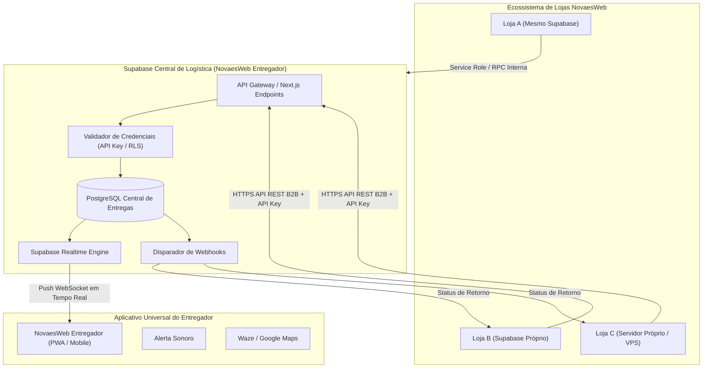
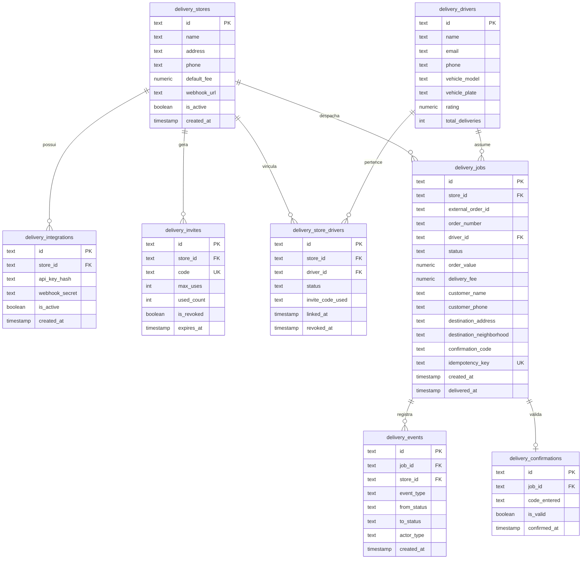
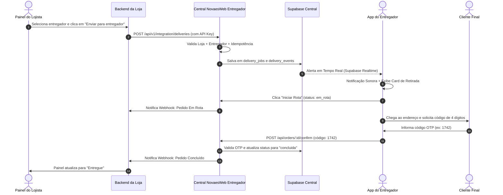

# NOVAESWEB ENTREGADOR — ARQUITETURA CENTRAL SUPABASE E INTEGRAÇÃO UNIVERSAL DE LOJAS

Este documento apresenta a **auditoria técnica completa**, o **modelo de dados do Supabase central**, o **contrato de integração de APIs** e o **Prompt Universal** para conectar qualquer loja NovaesWeb (seja 1, 100 ou 500+ lojas) a um único aplicativo universal de entregadores.

---

## 1. Diagnóstico da Estrutura Atual do Aplicativo

### 1.1 Estado do Frontend e Funcionalidades
- **Branding Universal:** O título oficial é **ENTREGADOR** sob a chancela NovaesWeb. Não há fixação de nome de estabelecimentos no código visual.
- **Isolamento Básico:** O app já possui seletor e filtro em memória/local por `store_id` e senha de 6 dígitos (`615210`).
- **Controle de Jornada:** O botão de online/offline e controles de turno foram removidos com sucesso, atendendo estritamente à regra operacional.
- **Fluxo Operacional do Entregador:** Alerta sonoro de nova entrega, visualização de dados do cliente, atalhos de GPS (Google Maps / Waze) e confirmação por OTP de 4 dígitos (`1742`).

### 1.2 Gaps Identificados para Suportar 100 a 500+ Lojas
1. **Ausência de API de Integração Externa (B2B):** Atualmente, as requisições partem da interface interna. Lojas externas precisam de uma API backend-to-backend autenticada por chave (`X-NovaesWeb-Store-Id` e `X-NovaesWeb-API-Key`) para enviar pedidos de forma automática e programática.
2. **Falta de Tabela de Credenciais / Chaves de API (`delivery_integrations`):** Não há tabela para armazenar as chaves de acesso emitidas para cada loja comercial, permitindo revogação e auditoria.
3. **Auditoria e Histórico de Eventos (`delivery_events`):** Falta rastreabilidade de quem alterou cada status (lojista, motoboy, sistema) e timestamp de cada transição.
4. **Idempotência no Despacho:** Não há validação de `idempotency_key` ou `external_order_id` para impedir duplicação de corridas caso a loja reenvie a requisição em caso de instabilidade de rede.
5. **Webhooks de Retorno para Lojas em Outros Bancos:** Quando a loja reside em outro projeto Supabase ou servidor externo, o sistema central precisa notificar o endpoint da loja quando o status mudar para `concluida` ou `em_rota`.

---

## 2. Arquitetura Final do Supabase Central

A plataforma de entregas centraliza a verdade operacional e comunica-se com as lojas em dois cenários suportados:



---

## 3. Modelo de Dados Central (PostgreSQL / Supabase)

O esquema foi projetado para alta concorrência, suporte a centenas de lojas e isolamento completo por chaves estrangeiras e índices:

### Diagrama Entidade-Relacionamento



### Políticas de Segurança (Row Level Security - RLS)
1. **Entregadores:**
   - Podem ler apenas seus próprios dados e os pedidos (`delivery_jobs`) vinculados a eles ou às lojas onde têm vínculo ativo (`delivery_store_drivers.status = 'active'`).
   - Não podem alterar o valor do pedido, taxa de entrega ou endereço da loja.
   - Só atualizam status de `aguardando_retirada` para `em_rota` e `concluida` (via OTP).
2. **Lojas (Comercial / Lojista):**
   - Podem ler e gerenciar apenas pedidos e entregadores vinculados ao seu próprio `store_id`.
   - Nenhuma loja consegue visualizar métricas ou pedidos de outros estabelecimentos.
3. **Backend / Integrações:**
   - Operações administrativas utilizam a `SUPABASE_SERVICE_ROLE_KEY` protegida no backend ou a `API-Key` da loja validada no gateway central. Nenhuma chave mestra é exposta ao navegador.

---

## 4. Contrato Técnico de Integração (API B2B Central)

Todas as lojas conectam-se utilizando os seguintes padrões HTTP:

### 4.1 Headers Obrigatórios em Todas as Requisições da Loja
```http
X-NovaesWeb-Store-Id: store-acai-01
X-NovaesWeb-API-Key: nx_sec_live_8f7b3a19e2...
Content-Type: application/json
```

### 4.2 Endpoints Oficiais

#### 1. Conexão / Registro da Loja
- **Endpoint:** `POST /api/v1/integration/stores/connect`
- **Objetivo:** Garante que a loja está cadastrada na logística e pronta para operar.
- **Corpo da Requisição:**
  ```json
  {
    "storeId": "store-acai-01",
    "name": "Açaí do Rei",
    "address": "Av. Boqueirão, 1200 - Canoas/RS",
    "phone": "(51) 99888-7777",
    "defaultDeliveryFee": 8.00,
    "webhookUrl": "https://loja.com/api/webhooks/delivery"
  }
  ```

#### 2. Geração de Convite para Entregador
- **Endpoint:** `POST /api/v1/integration/invites`
- **Corpo:** `{ "maxUses": 1, "validityHours": 48 }`
- **Retorno:**
  ```json
  {
    "success": true,
    "code": "NX-ACAI-7821",
    "expiresAt": "2026-10-30T16:00:00Z"
  }
  ```

#### 3. Listagem de Entregadores Vinculados
- **Endpoint:** `GET /api/v1/integration/drivers`
- **Retorno:**
  ```json
  {
    "success": true,
    "drivers": [
      {
        "id": "mb-001",
        "name": "Carlos Silva",
        "phone": "(11) 97123-4567",
        "vehicle": "Honda CG 160 Fan - BRA-2E19",
        "rating": 4.9,
        "status": "active"
      }
    ]
  }
  ```

#### 4. Despacho Idempotente de Pedido
- **Endpoint:** `POST /api/v1/integration/deliveries`
- **Corpo:**
  ```json
  {
    "externalOrderId": "ped-8921",
    "idempotencyKey": "store-acai-01_ped-8921_v1",
    "assignedDriverId": "mb-001",
    "customer": {
      "name": "Mariana Souza",
      "phone": "(51) 98765-4321",
      "address": "Rua das Flores, 456",
      "neighborhood": "Centro - Canoas/RS"
    },
    "orderValue": 48.90,
    "deliveryFee": 8.00,
    "confirmationCode": "1742"
  }
  ```
- **Retorno (201 Created):**
  ```json
  {
    "success": true,
    "deliveryId": "job-0499",
    "status": "aguardando_retirada",
    "orderNumber": "#0499",
    "confirmationCode": "1742"
  }
  ```

#### 5. Consulta de Status e Histórico
- **Endpoint:** `GET /api/v1/integration/deliveries/:id`
- **Retorno:** Status atual (`aguardando_retirada`, `em_rota`, `concluida`), horários de saída e entrega, e dados do motoboy.

---

## 5. Fluxo de Vida do Pedido e Confirmação OTP



---

## 6. Especificação da Área "Entregadores" no Painel da Loja

O lojista terá no seu próprio painel comercial uma seção dedicada com:

1. **Card de Convite:**
   - Botão **"Gerar Código de Convite"**.
   - Exibição do código (ex: `NX-ACAI-7821`) com botão de cópia de texto formatado para envio direto via WhatsApp:
     > *"Olá! Para receber nossas entregas no app NovaesWeb Entregador, use nosso código de vinculação: **NX-ACAI-7821**."*
2. **Tabela de Entregadores Autorizados:**
   - Nome, telefone, modelo da moto e placa.
   - Status (Ativo / Inativo).
   - Botão **"Desvincular"** (revoga acesso imediatamente).
3. **Seletor de Entregador no Pedido:**
   - Dentro da tela de cada pedido pronto para envio, um dropdown lista os entregadores ativos da loja.
   - Botão de ação: **"Despachar para Entregador"**.
   - Badge com o status da entrega atualizado em tempo real via webhook ou polling (`Aguardando Retirada` ➔ `Em Rota` ➔ `Entregue`).

---

## 7. Plano de Implementação por Etapas

| Etapa | Ação | Status / Entregável |
| :---: | :--- | :--- |
| **Etapa 1** | **Validação & Aprovação do Plano** | Aguardando feedback do usuário |
| **Etapa 2** | **Migração SQL no Supabase Central** | Script DDL completo idempotente (`delivery_stores`, `delivery_integrations`, etc.) |
| **Etapa 3** | **Gateway de Integração B2B (`/api/v1/integration/*`)** | Autenticação por API Key, validação e registro de lojas |
| **Etapa 4** | **Motor de Idempotência e Auditoria** | Criação de jobs com `idempotency_key` e tabela de eventos |
| **Etapa 5** | **Webhook Dispatcher** | Notificação de retorno de status para lojas externas |
| **Etapa 6** | **Homologação Multiloja com 2 Lojas Diferentes** | Teste isolado com Loja 1 e Loja 2 |
| **Etapa 7** | **Disponibilização do Prompt Universal** | Documento final pronto para replicação |

---

## 8. Testes de Homologação Multiloja

Para comprovar o isolamento e o funcionamento universal, o plano prevê teste automatizado com duas lojas de teste:
1. **Loja 1: "Burger House"** (`store-burger-test`)
2. **Loja 2: "Fogo na Brasa"** (`store-fogo-test`)

**Cenários validados no teste:**
- Ambas geram códigos independentes (`NX-BURG-...` e `NX-FOGO-...`).
- Motoboy A vincula-se à Loja 1; Motoboy B vincula-se à Loja 2.
- Loja 1 despacha o Pedido #101 para o Motoboy A.
- Loja 2 despacha o Pedido #201 para o Motoboy B.
- Motoboy A **não enxerga** o Pedido #201 e Loja 1 **não enxerga** o Motoboy B.
- Conclusão com OTP e atualização de faturamento independente.

---

## 9. PROMPT UNIVERSAL — CONECTAR LOJA NOVAESWEB AO APP ENTREGADOR

> [!IMPORTANT]
> O texto a seguir é o prompt completo, pronto para ser copiado e enviado para a IA ou equipe responsável pelo desenvolvimento de qualquer nova loja da NovaesWeb.

```markdown
# PROMPT UNIVERSAL — CONECTAR LOJA NOVAESWEB AO APP ENTREGADOR

Você é o engenheiro de software responsável por integrar o painel comercial desta loja ao sistema central de logística **NovaesWeb Entregador**.

## 1. Visão Geral
O NovaesWeb Entregador é uma plataforma logística centralizada compartilhada entre todas as lojas da NovaesWeb.
Você **NÃO DEVE** criar um aplicativo de entregadores nem duplicar tabelas de motoristas.
Sua missão é apenas conectar o painel comercial desta loja à API do sistema central.

## 2. Dados de Conexão com a Central de Entregas
- **Central API URL:** https://[SEU-DOMINIO-ENTREGADOR]/api/v1/integration
- **Supabase URL Central:** https://nrdbporbyujwtgnpiejz.supabase.co
- **Headers Obrigatórios:**
  - `X-NovaesWeb-Store-Id`: [ID_OFICIAL_DA_LOJA] (ex: acai-do-rei-canoas)
  - `X-NovaesWeb-API-Key`: [CHAVE_DE_API_FORNECIDA_PELA_CENTRAL]
  - `Content-Type`: application/json

## 3. O que deve ser implementado no Painel desta Loja

### 3.1 Aba "Entregadores" no Painel da Loja
Criar no painel administrativo uma seção chamada **Entregadores** que consome a API central:
1. **Gerar Convite para Entregador:**
   - Requisição: `POST /api/v1/integration/invites`
   - Resposta: Código gerado (ex: `NX-LOJA-4821`).
   - Botão para copiar texto pronto para WhatsApp:
     *"Use o código NX-LOJA-4821 no app NovaesWeb Entregador para se vincular à nossa loja."*
2. **Listar Entregadores Vinculados:**
   - Requisição: `GET /api/v1/integration/drivers`
   - Exibir tabela com: Nome, Telefone, Moto, Placa e Status.
3. **Revogar Vínculo:**
   - Requisição: `PATCH /api/v1/integration/drivers/:id/revoke`
   - Impede imediatamente o motoboy de receber novas entregas desta loja.

### 3.2 Despacho de Pedidos na Tela de Detalhes do Pedido
Na tela de pedidos da loja, quando o pedido estiver pronto para entrega:
1. Exibir um campo de seleção (dropdown) com os entregadores ativos da loja (obtidos via `GET /api/v1/integration/drivers`).
2. Botão de ação: **"Enviar para Entregador"**.
3. Ao clicar, o backend da loja envia a requisição para a central:
   - Requisição: `POST /api/v1/integration/deliveries`
   - Corpo:
     ```json
     {
       "externalOrderId": "pedido_12345",
       "idempotencyKey": "loja-xyz_pedido_12345_v1",
       "assignedDriverId": "id_do_motoboy_selecionado",
       "customer": {
         "name": "Nome do Cliente",
         "phone": "(XX) 9XXXX-XXXX",
         "address": "Rua, Número, Complemento",
         "neighborhood": "Bairro - Cidade/UF"
       },
       "orderValue": 45.90,
       "deliveryFee": 8.00,
       "confirmationCode": "1742"
     }
     ```
4. A central registra a entrega, emite o alerta sonoro no aplicativo do motoboy e retorna o ID da entrega.

### 3.3 Acompanhamento do Status
A loja pode receber atualizações de status via:
- **Webhook:** Cadastre o webhook da loja para receber notificações automáticas de `em_rota` e `concluida`.
- **Polling / Consulta direta:** `GET /api/v1/integration/deliveries/:id`.

## 4. Regras Obrigatórias de Segurança
- As chamadas para a Central de Entregas devem ser feitas **pelo backend da loja**. Nunca exponha a `API-Key` no frontend/React/Vue.
- Envie sempre uma `idempotencyKey` única por pedido para evitar despachos duplicados em caso de lentidão ou retry.
- O código de confirmação (`confirmationCode`) deve ser gerado pelo sistema comercial e fornecido ao cliente (ex: no WhatsApp ou rastreio) para que ele informe ao motoboy na entrega.
```

---

## 10. Relatório de Arquivos Envolvidos

1. [supabase_setup.sql](file:///C:/Users/camil/.gemini/antigravity/scratch/novaesweb-entregador/supabase_setup.sql): DDL oficial com as tabelas normalizadas e RLS.
2. [src/lib/db.ts](file:///C:/Users/camil/.gemini/antigravity/scratch/novaesweb-entregador/src/lib/db.ts): Camada de persistência, métodos de integração e isolamento multiloja.
3. `src/app/api/v1/integration/*`: Endpoints da API B2B para integração com as lojas comerciais.
4. [src/components/LojistaPanelModal.tsx](file:///C:/Users/camil/.gemini/antigravity/scratch/novaesweb-entregador/src/components/LojistaPanelModal.tsx): Painel de gestão do lojista já integrado para homologação.
5. [src/components/screens/ScreenLinkStore.tsx](file:///C:/Users/camil/.gemini/antigravity/scratch/novaesweb-entregador/src/components/screens/ScreenLinkStore.tsx): Tela do entregador para vincular lojas via código.
